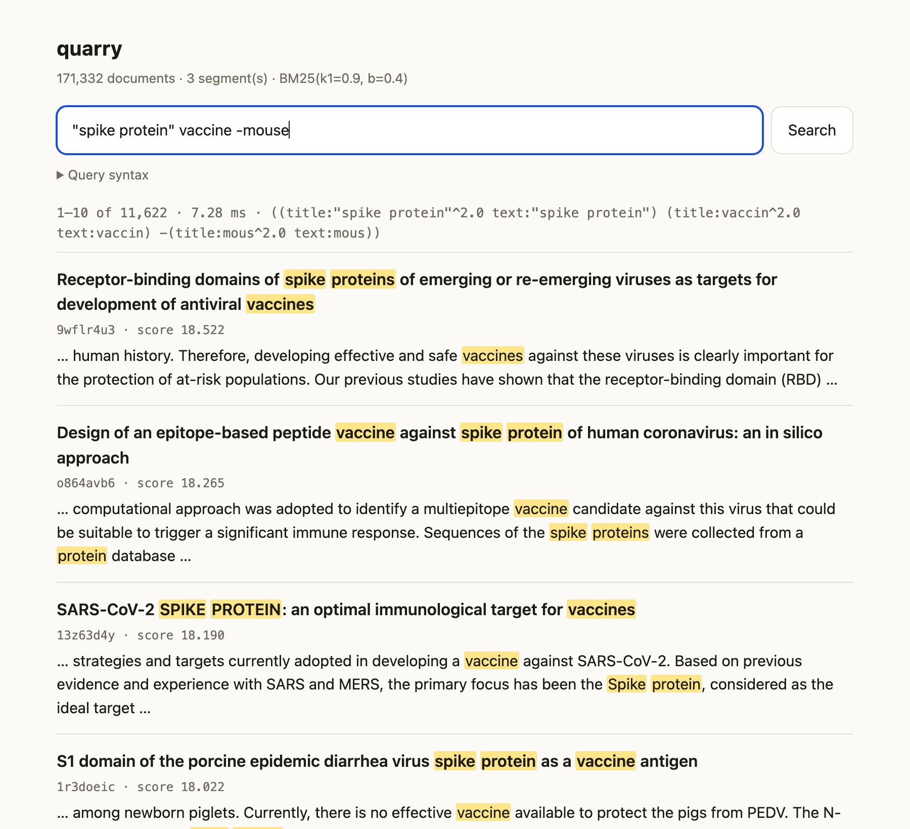

# quarry

[](https://github.com/pMag11-alt/quarry/actions/workflows/ci.yml)

A full-text search engine written from scratch in Kotlin. It has Lucene-compatible text analysis, BM25 ranking, a compressed segment-based inverted index with updates, deletes and merging, a query language, and an HTTP API with a search page. The engine uses only the Kotlin and Java standard libraries.

It matches **Apache Lucene 10.5** exactly. On seven [BEIR](https://github.com/beir-cellar/beir) benchmarks (13,727 queries over up to 523K documents), quarry returns the same top 1000 documents in the same order as Lucene for every query, with bit-identical scores. A harness indexes each dataset with both engines and diffs every ranked list, and CI runs it on every push.



## Results

BM25 (k1 = 0.9, b = 0.4) over title + text, English analysis, bag-of-words queries built the way Anserini and Pyserini build them, scored with BEIR's conventions (trec_eval tie-breaking, a document whose id equals the query's is dropped):

| dataset | docs | queries | nDCG@10 | Recall@100 | same top-1000 as Lucene | largest score difference |
|---|---:|---:|---:|---:|---:|---:|
| SciFact | 5,183 | 300 | 0.6789 | 0.9253 | 300 / 300 | 0 |
| NFCorpus | 3,633 | 323 | 0.3206 | 0.2457 | 323 / 323 | 0 |
| ArguAna | 8,674 | 1,406 | 0.3970 | 0.9324 | 1,406 / 1,406 | 0 |
| SCIDOCS | 25,657 | 1,000 | 0.1490 | 0.3477 | 1,000 / 1,000 | 0 |
| FiQA-2018 | 57,638 | 648 | 0.2361 | 0.5395 | 648 / 648 | 0 |
| TREC-COVID | 171,332 | 50 | 0.5935 | 0.1091 | 50 / 50 | 0 |
| Quora | 522,931 | 10,000 | 0.7884 | 0.9734 | 10,000 / 10,000 | 0 |

### Speed

Lucene is faster, and these numbers don't hide it. Both engines ran in the same JVM (JDK 21 on an Apple M3, one query at a time, after warm-up), and Lucene had its SIMD vector module enabled. Indexing times include merging down to one segment.

| dataset | index, quarry / Lucene | ms/query at k=1000, quarry / Lucene | ms/query at k=10, quarry / Lucene |
|---|---:|---:|---:|
| SciFact | 0.6 s / 0.5 s | 0.65 / 0.53 | 0.17 / 0.20 |
| NFCorpus | 0.3 s / 0.3 s | 0.10 / 0.09 | 0.03 / 0.06 |
| ArguAna | 0.5 s / 0.3 s | 3.78 / 1.22 | 2.54 / 0.63 |
| SCIDOCS | 1.5 s / 0.9 s | 0.66 / 0.32 | 0.18 / 0.09 |
| FiQA-2018 | 2.4 s / 1.3 s | 1.34 / 0.62 | 0.47 / 0.18 |
| TREC-COVID | 12.1 s / 5.2 s | 3.21 / 1.42 | 1.10 / 0.39 |
| Quora | 3.0 s / 1.1 s | 2.67 / 1.14 | 0.61 / 0.28 |

On the two smallest collections quarry answers top-10 queries faster than Lucene, where fixed per-query overhead dominates. Everywhere else a query takes about 1.1–4× as long as it does in Lucene, and indexing takes 1–2.7× as long. Lucene has optimizations that quarry doesn't: SIMD postings decoding, block-max impacts that skip whole blocks of documents, and a heavily tuned indexing chain. ArguAna is the worst case, because its queries are entire arguments with dozens of terms.

## Features

- **Analysis**: a reimplementation of Lucene's `StandardTokenizer`, which applies the UAX #29 word-break rules over Unicode 12.1 properties. It covers emoji sequences, Southeast Asian scripts, Han and Hiragana, Katakana, numbers and Hebrew quotes. On top of it sits the `EnglishAnalyzer` chain: possessive removal, lower-casing, Lucene's 33 stop words and the Porter stemmer.
- **Index**: immutable memory-mapped segments with CRC32 checksums. Postings are bit-packed in blocks of 128 with skip tables, and positions are stored too. Each segment also holds a prefix-compressed term dictionary, one-byte length norms, per-term impacts and Deflate-compressed stored fields.
- **Writes**: add, update and delete documents by id. Commits are atomic and readers keep a point-in-time view. Merging is tiered, `forceMerge` is available, and a lock file allows one writer per index.
- **Queries**: terms, Boolean queries (must / should / filter / must-not / minimum match), exact and sloppy phrases, prefix, fuzzy (edit distance with transpositions), match-all, boosts, multi-field search and a Lucene-style query parser.
- **Top-k**: MaxScore dynamic pruning for disjunctive queries. It returns exactly the exhaustive top k while scoring a fraction of the matching documents.
- **Serving**: a JSON HTTP API for searching (with highlighted snippets and paging), adding and deleting documents, and statistics, plus a search page.
- **Evaluation**: a BEIR loader, nDCG / Recall / MRR computed the way trec_eval computes them, TREC run files, and the Lucene comparison harness.

## How it works

### Tokenizing like Lucene

Lucene's tokenizer is a JFlex-generated automaton. quarry gets the same token boundaries from a small hand-written state machine over word-break classes (ALetter, Numeric, MidLetter, Katakana, Hebrew_Letter, ExtendNumLet, …). The state machine handles the longest-match rule and the cases where a mid-word character is only accepted if a letter follows. Separate matchers handle runs of Southeast Asian, Han and Hiragana characters, and the emoji grammar (modifier sequences, ZWJ sequences, keycaps, flags and tag sequences). The property tables are generated from the Unicode 12.1 data files by `scripts/gen_unicode.py` into a 1,353-run table loaded at startup.

The test suite checks token text, positions and offsets against Lucene on hand-picked tricky strings, and fuzzes both tokenizers with random strings drawn from an alphabet of boundary-sensitive characters. Each mismatch is shrunk to a minimal failing input. Tokenizer bugs found this way included a variation selector followed by a Thai mark, a lone emoji modifier after a ZWJ, and a Hebrew letter–quote–letter run followed by a mid-word character. 2.4 million random strings now tokenize identically. The Porter stemmer is checked against Lucene's on more than 15,000 generated words.

### Segments

A segment is one file, written once and then memory-mapped:

```
magic "QRYSEG01"
stored fields      Deflate chunks of 64 documents
id table           (id → doc) sorted by id, and doc → id offsets
per field          norms (1 byte/doc), postings, positions, term dictionary + block index
table of contents, its offset, magic, CRC32 of everything before it
```

For each term, the postings list starts with a skip table, then holds blocks of 128 documents. Each block stores doc gaps and frequencies bit-packed at the block's widest value, and a block whose frequencies are all one stores none. The documents left over after the last full block are written as varints. `advance(target)` binary-searches the skip table's last-doc-per-block entries, so it decodes only the block that holds the target. Every dictionary entry stores the term's *impacts*: the (frequency, length) pairs not dominated by any other posting, from which a query computes the term's exact highest possible score.

Deletes are bitsets in a separate `.del` file per segment generation. A commit writes new segments and delete files, then atomically replaces `segments.json`. Files that no manifest references are removed after the commit. A crash at any point leaves the previous commit intact. Merging streams the k-way union of the input segments' dictionaries, renumbers documents and drops deleted ones.

### Scoring exactly like Lucene

Equal rankings come easily. Equal scores to the last bit depend on doing the same float arithmetic as Lucene:

- Document lengths go through Lucene's lossy one-byte `SmallFloat` encoding. Scores use the encoded length, not the true length.
- `idf = ln(1 + (N − df + 0.5) / (df + 0.5))` is computed in double precision and rounded to float. The score is then `weight − weight / (1 + freq × normInverse)` in float, where `normInverse = 1 / (k1 × (1 − b + b × dl / avgdl))`. This is the rearranged form Lucene's `BM25Similarity` uses, and the 256 possible values of `normInverse` are precomputed.
- Clause scores are summed in double precision and rounded to float once. Collection statistics (`N`, `avgdl`) count only documents that have the field, and they include deleted documents, as Lucene's do.
- Equal scores are ordered by internal document number.

The parity test builds the same corpus in both engines (several segments, with deletions) and compares term, Boolean, filter, must-not and exact-phrase queries, plus 200 random weighted bag-of-words queries. Each query runs with and without pruning and must match Lucene exactly, including hit counts.

### MaxScore

For a disjunction of terms, the scorers are sorted by their maximum possible contribution, and a running sum of those maxima is kept. Once the top-k heap is full, its lowest score is a threshold. A document that matches only terms whose maxima sum to at most the threshold cannot enter the heap. Those *non-essential* terms never produce candidates. They are only probed with `advance()` for documents found through the essential ones, and the probing stops as soon as the remaining terms can't lift the document over the threshold. On FiQA this scores about 7,000 documents per query at k=10, against more than 16,000 at k=1000. The test suite checks the pruned and exhaustive results for equality at k = 1, 10, 100 and 1000.

I also implemented block-max MaxScore (per-block impacts in the skip table, tighter bounds per block). It scored 2–8% fewer documents but ran slower, because the extra bookkeeping cost more than it saved, so it was taken out.

## Usage

Requires JDK 21 or newer.

```bash
./gradlew installDist
```

```bash
build/install/quarry/bin/quarry index my-index docs.jsonl --fields title,text
```

```bash
build/install/quarry/bin/quarry search my-index '"memory safety" +rust -java'
```

```bash
build/install/quarry/bin/quarry serve my-index --port 8080
```

Documents are JSON lines with an `id` (or `_id`) and text fields. Other commands: `stats`, `delete <ids>`, `check` (verify checksums) and `eval`; run `quarry help` for options.

### Query syntax

| query | meaning |
|---|---|
| `rust memory safety` | any of the words, ranked by BM25 |
| `+rust -java`, `rust AND java`, `NOT java` | required, prohibited |
| `(a OR b) c` | grouping |
| `"memory safety"`, `"memory safety"~3` | exact and sloppy phrases |
| `title:rust`, `title:(a b)` | one field |
| `tok*`, `colour~1` | prefix, fuzzy (max edits) |
| `rust^2` | boost |

Words go through the analyzer, so `Running` finds `run`. Unfielded words search every field.

### HTTP API

```
GET    /search?q=...&k=10&offset=0   hits with fields, scores and <mark>ed snippets
GET    /docs/{id}                    a stored document
POST   /docs                         add or replace: a JSON object, an array, or JSON lines
DELETE /docs/{id}                    delete a document
GET    /stats                        documents, segments, field statistics
GET    /                             the search page
```

```bash
curl -X POST localhost:8080/docs -d '{"id": "42", "title": "Skip lists", "text": "..."}'
```

Searches run concurrently against a point-in-time reader. Writes go through one writer, and each write request commits and then reopens the reader.

### Reproducing the benchmarks

```bash
scripts/download_beir.sh scifact nfcorpus arguana scidocs fiqa trec-covid quora
```

```bash
build/install/quarry/bin/quarry eval data/scifact
```

```bash
./gradlew compareLucene -Pdatasets=data/scifact,data/fiqa
```

`eval` prints nDCG@10, Recall@100, MRR@10, latency and the number of documents scored per query. `compareLucene` prints a row of the tables above per dataset (add `-Pk=10` for the k=10 timings) and exits non-zero if any query's results differ from Lucene's.

## Testing

```bash
./gradlew test
```

- `LuceneAnalysisParityTest`: tokenizer and analyzer output (terms, positions, offsets) against Lucene on tricky text, random fuzzing with shrinking, the Porter stemmer and the stop words. Set `QUARRY_FUZZ=<n>` and `QUARRY_FUZZ_SEED=<s>` for longer runs.
- `LuceneScoringParityTest`: Lucene's `SmallFloat` encoding, and scores, rankings and hit counts against Lucene across segments and deletions.
- `IndexTest`: varint and bit-packing round trips, and postings iteration and `advance()` against a plain sorted list. It also covers the add, update, delete, commit, reopen and merge lifecycle, the single-writer lock, detection of a flipped byte, and field statistics.
- `SearchTest`: MaxScore against exhaustive search, the query parser, phrase / prefix / fuzzy / Boolean semantics, edit distance, the trec_eval metrics and JSON.

`scripts/smoke.sh` runs the installed CLI and the HTTP API end to end. CI runs the tests on Linux and macOS (JDK 21 and 25), the smoke test, the Lucene comparison on four BEIR datasets, and 300,000 tokenizer fuzz strings.

## Layout

```
src/main/kotlin/quarry/
  analysis/   StandardTokenizer, Unicode12 tables, PorterStemmer, EnglishAnalyzer
  index/      SegmentWriter, Segment (reader, postings), IndexWriter, IndexReader, SmallFloat, Bytes
  search/     Query, QueryParser, BM25, Scorers, Searcher (MaxScore, top-k), Highlighter
  server/     SearchServer (HTTP API) and resources/quarry/ui.html
  eval/       BEIR loader and metrics
  json/       JSON parser and writer
src/compare/  the Lucene comparison harness (Lucene is only a test dependency)
src/test/     parity, index and search tests
scripts/      Unicode table generator, BEIR downloader, smoke test
```

## Limitations

- English analysis only, BM25 only, and text fields only: no numeric or range fields, facets, sorting by field, or term vectors.
- Sloppy phrases use a simpler matcher than Lucene's, so their scores can differ from Lucene's when terms repeat. Exact phrases match.
- Prefix and fuzzy queries scan the whole term dictionary, score as a constant, and expand to at most 4,096 terms per segment.
- Each query runs on one thread. Each HTTP write commits immediately, so bulk loads should use the CLI.
- Highlighting re-analyzes the stored text instead of storing offsets.

## License

MIT
